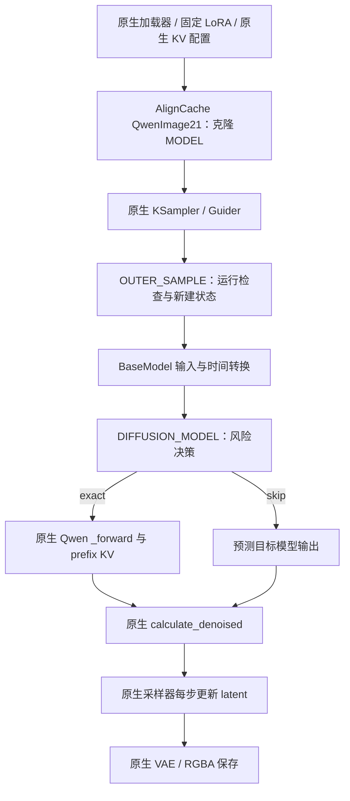

# Qwen-Image-2.1 的 AlignCache 加速与 ComfyUI 适配开发方案

本文保留最初设计背景。当前安装、实现结构和支持范围以 [README.md](README.md) 为准；
离线评测工具与历史原始记录独立保留在开发环境中，不属于本次插件交付。

日期：2026-09-21。交付状态：源码调研与开发设计，尚未实现 Qwen 加速节点，也未进行真实模型 GPU 性能验证。

## 1. 目标与结论

根据本次确认，目标模型为 **Qwen-Image-2.1**；Wan2.1 提供 AlignCache 方法依据，已有 MiniMax H3 代码提供 ComfyUI 插件组织和 wrapper 接入范例。

建议新增 `AlignCache4QwenImage21`，交付 `MODEL → MODEL` 自定义节点，复用原生模型加载、文本／参考图编码、采样、RGBA VAE 与图像保存。采用 `OUTER_SAMPLE` 管理一次采样的状态，在 `DIFFUSION_MODEL` 边界决定执行原生 Transformer，或返回预测的目标图像模型输出。**跳过的是模型计算，采样时间表及每一步 latent 更新仍完整执行。**

首版以官方 ComfyUI 示例的 **25 步、CFG=1、Euler、simple、batch=1** 为验证基线，先完成 trace，再开放经校准的 on。默认保留原生 prefix KV cache；加速结果必须对比已经使用该缓存的原生基线。文生图先验收，单／多参考图编辑和透明输出分别验收，不以文生图成绩代替编辑质量。[文生图模板][T2I]、[编辑模板][EDIT]

本方案不要求另建 Diffusers 独立推理入口。脚本用于驱动 ComfyUI 工作流、轨迹校准、性能与质量比较；不存在本次已经可运行的 `aligncache_generate.py`。

## 2. 源码依据与版本

| 对象 | 本次检查的提交 | 用途 |
| --- | --- | --- |
| 当前 AlignCache 项目 | `865add4ff38d89151bfaea6f6df77c0f9e2ecbc2` | Wan2.1 算法和 H3 原型 |
| QwenLM/Qwen-Image-2.1 | `fb7ae1d1f9611cd91524d03c53c5246b36ac8577` | 官方架构、能力及接入说明 |
| Comfy-Org/ComfyUI | `b0f4b7b294ce482a2e071d9d762c133d38c7aa07` | 实际模型、wrapper、采样和 KV 实现 |
| Comfy-Org/workflow_templates | `371a7b7171bbd11e9cc92ef615ba5ad223d7e5b4` | 工作流基线 |

复用了项目内已有的 `.tmp/aligncache-design-reference/` 克隆及工作流快照，并检查上述三个参考仓库工作区干净。没有下载权重。下文使用固定提交链接，不依赖临时目录长期保留。正式开发需把 ComfyUI、Torch、CUDA、插件版本、权重哈希、量化方式、attention 后端及工作流哈希写入运行清单。

官方 Qwen 仓库主要提供说明和 prompt rewrite 工具；本次所需的实际 ComfyUI Transformer 位于 `comfy/ldm/qwen_image21/model.py`，不是旧版 `qwen_image/model.py`。不能仅根据仓库名称或旧 Qwen 插件推测接口。

### 2.1 已核实的结构与语义

| 项目 | 事实 | 对设计的影响 |
| --- | --- | --- |
| 图像模型 | 默认 32 层单流 DiT，输入／输出为 64 latent 通道 | 单路目标图像输出；不迁入 H3 双模态控制 |
| wrapper 输入 | `x` 为 `[B,C,H,W]`，参考图单独传 `ref_latents` | 只预测目标张量，不拼接参考图到缓存输出 |
| wrapper 返回 | `_forward` 投影后的 `[B,out_channels,H,W]` 张量 | 缓存模型原始输出，不缓存最终 RGB／RGBA 或 x0 |
| 时间 | `ModelSamplingFlux.timestep(sigma)` 返回 sigma；模型内部处理精度和时间嵌入 | 不除以 1000，不用 H3 的 `1-sigma` 或音视频 shift 公式 |
| 去噪换算 | `CONST.calculate_denoised` 计算 `x - sigma * model_output` | 输出属于该 Flow 速度约定；仍交给原生 BaseModel 换算 |
| 前缀 | 文本和参考图使用 t=0 调制，block-causal attention | 原生前缀缓存可与目标输出近似缓存叠加 |
| 原生采样基线 | 两份 ComfyUI 模板为 25 步、CFG=1、Euler/simple | 不将官方 Diffusers README 的 40 步混作相同 benchmark |

上述结论分别依据 [Transformer][MODEL]、[BaseModel][BASE]、[ModelSampling][SAMPLING]、[模型识别配置][SUPPORTED]。RGBA 是解码能力；不能把 64 维 latent 的最后一个通道当作 alpha 通道。

## 3. 如何继承 Wan2.1 和 H3

### 3.1 保留的方法

Wan2.1 的主要参考符号为 `_wan_aligncache_forward`、`_predict_pair_residual`、`_fb_route_pair`、`_fb_update_from_exact_feedback`，位于 `AlignCache4Wan2.1/aligncache_generate.py`。保留以下结构：

1. 用输入变化和历史输出变化建立风险增量，并累积 skip budget。
2. early/mid/late 分阶段阈值，叠加有界在线反馈系数。
3. 历史输出或残差的缩放、动量预测，以及方向／幅值稳定性门控。
4. warmup、tail、历史不足、最大缓存年龄触发精确刷新。
5. 精确刷新前先生成反事实草稿，用真实输出校正风险代理。

Qwen 采用下文明确给出的变体，不宣称逐项复现 Wan：Wan 按 cond/uncond CFG 对决策，反馈比较 CFG 合成输出的 relative MSE；Qwen 首版按单条件模型评估决策，使用 relative L2，并只从真实精确锚点学习。Wan 当前输入／输出历史更新口径也与这里的“两个精确锚点”不同。必须分别命名、记录配置和校准，不能搬用 `base_thresh=0.065`、`warmup_pairs=12`。

### 3.2 复用 H3 的组织方式，修正其局限

| H3 参考实现 | Qwen 开发决策 |
| --- | --- |
| `comfyui_nodes.py` 的克隆 MODEL、两个 wrappers | 沿用接口形式，使用 Qwen 独立命名空间 |
| `ComfyH3RunState` | 新建每次 outer sample 的 Qwen RunState |
| `AlignCacheH3Controller` | 参考配置／决策／预测／提交分离，改为单路控制器 |
| video/audio 阈值和联合跳过 | 删除双路、音视频时间变换和 H3 payload 依赖 |
| trace/on 和 JSONL/JSON | 保留，但必须调用同一个 predictor API |
| 每次 wrapper 调用直接 `next_step += 1` | 分开记录 logical step 与 model evaluation，并验证映射 |
| 同 key 直接追加 wrapper | attach 时先移除自己的 key，再注册一次 |
| 多次逐步 CUDA synchronize | 正常运行不逐步同步；仅 profiler 模式使用细粒度计时 |

H3 的 Python 文件还依赖自身采集器和命令行工具；Qwen 不应通过导入整个 H3／Wan 脚本引入它们的模型依赖。首轮先做轻量独立控制器；待两模型行为稳定，再决定是否抽取公共库，不在本次迁移中改动既有后端。

## 4. 原生 prefix KV 与 AlignCache 的共存

原生缓存保存每层文本／参考图 K/V，AlignCache 保存少量目标输出锚点，两者缓存对象不同。

- `QwenImage21.current_patcher` 的 setter 在 pre_run／cleanup 时重置前缀缓存；存在 hook patches 时不会开启这一路缓存。[生命周期][BASE]
- `_forward` 遇到 `post_input`、`single_block`、`attn1_patch` 或 DiT block replacement 时禁用自身前缀缓存。AlignCache 首版遇到这些修改也转为精确执行，因为跳过整个模型还会跳过 hook 的计算和副作用。[模型实现][MODEL]
- 原生 `prefix_cache_key` 包含文本内容、参考 latent 内容、slots 和目标空间尺寸；“参考图数量相同”不是缓存等价条件。[模型实现][MODEL]
- `QwenImage21Cache` 提供 device=`auto/gpu/cpu/off` 和 dtype=`default/int8/int4`，不插入该节点时仍使用原生默认策略。[缓存配置节点][QNODES]

**精确路径**：通过 `executor(...)` 进入原生 `_forward`，由上游决定填充或读取 KV。首个有效模型评估必须精确执行，但不要求 KV 一定成功驻留；原生可能因内存策略退回重算前缀。

**skip 路径**：直接返回预测目标输出，不调用 `_forward`，不读取、不写入、不释放 prefix cache。下一次 exact 继续使用原生缓存机制。插件不得手动设置 `current_patcher` 或逐步调用 `reset_prefix_cache`。

原生 prefix cache 因内存不足未命中，不自动意味着 AlignCache 的输出锚点失效；条件、模型或布局改变才要求失效。反过来，KV 命中也不证明目标输出可以跳过。

组合基线至少有：原生 KV/default + AlignCache off、原生 KV/default + AlignCache on；另做 KV off 与量化 KV 消融。不得用“KV off 的慢基线”与“KV on + AlignCache”比较后，把全部收益计为 AlignCache。量化 KV 的近似误差也需与 AlignCache 误差分开报告。

## 5. ComfyUI 接入与兼容性



### 5.1 准确的 wrapper 参数

以下为接口设计示意，不是本次已实现代码：

```python
def qwen21_diffusion_wrapper(
    executor,
    x,
    timestep,
    context,
    ref_latents=None,
    image_slots=None,
    transformer_options=None,
    **kwargs,
):
    # 原生 forward 将上述六项按此顺序传给 wrapper。
    # kwargs 继续透传，包括 BaseModel 带入的 control 等参数。
    return executor(
        x,
        timestep,
        context,
        ref_latents,
        image_slots,
        transformer_options,
        **kwargs,
    )
```

与 H3 不同，`transformer_options` 前面有 `ref_latents` 和 `image_slots`。照搬 H3 签名会把参考 latent 当成 options。精确调用必须使用收到的 `executor`，不能直接调用私有 `_forward` 绕过包装链。返回预测必须与真实返回值的 shape、dtype、device 一致，尤其不能用输入 dtype 猜测输出 dtype。

### 5.2 首版支持范围

| 场景 | off / trace | on |
| --- | --- | --- |
| 官方 QwenImage21、单 GPU、B=1、固定单条件、CFG=1、Euler/simple | 支持 | P1 验收对象 |
| 固定单图编辑 | 支持采集 | P2 独立标定后开放 |
| 固定多参考图、RGBA | 支持采集 | P2 专项质量门槛通过后开放 |
| 固定 LoRA、不同模型量化、KV CPU/GPU/量化 | 基线分别记录 | 独立兼容配置，不能继承已有质量结论 |
| CFG>1、分批 cond/uncond、regional conditioning、ControlNet、动态条件或权重 hooks | 原样透传／采集 | 首版整次运行禁用 skip |
| Heun、多评估 DPM、自适应／SDE、Euler 非零 churn、未知采样器 | 可做调用观测，不假定一步一调用 | 首版不开放 |
| 多 GPU、并发共享同一个底层模型、torch.compile/CUDA Graph、其他近似缓存插件 | 需专项验证 | 首版不开放 |
| 非 QwenImage21 | attach 给出明确模型不匹配提示 | 不安装本模型的 wrapper |

CFG=1 不足以证明一次 sigma 只有一次前向：同一步可能有条件分区／分批。首次允许跳过前，应检查 guider 条件结构、sampler 实际函数及 extra_options、模型 patch/hook、其他 wrappers。只放行已测试的组合；对无法判断副作用的外部 wrapper，on 降级精确并记录原因。

未来 CFG>1 扩展必须基于 `cond_or_uncond`、条件身份和批次布局管理独立锚点／成对策略，不能恢复 Wan 的调用奇偶判定。首版不做这一扩展。

### 5.3 逻辑步与运行状态

`OUTER_SAMPLE` 的原生参数包含 `noise, latent_image, sampler, sigmas, ...`。显式绑定位置和关键字参数，不能只写 `sigmas=args[3]`。以实际传入、可能被 denoise/start/end 截断的 sigmas 为准，令 `N=len(sigmas)-1`；末尾零 sigma 通常不是单独的模型评估。

对首版 Euler：预期每个 `sigmas[k]` 对应一次条件模型评估。通过实际 `model_sampling.timestep(sigmas[k])` 与传入 timestep 比对，使用符合数据类型的容差；同时记录 `logical_step=k`、`eval_index`、原始 sigma 和实际 timestep。重复／乱序／非有限时间、额外评估或布局变化触发精确降级，后续不再 skip。结束后计数核对用于审计，不能代替跳过前的契约检查。

节点配置为不可变对象；attach 只克隆 ModelPatcher，不创建活跃缓存。每次 outer sample 新建 `run_id` 和 RunState，clone 本次 model_options 后挂载状态引用，通过原生 options 传播到 diffusion wrapper。需用真实 ComfyUI 契约测试验证传播，不能仅通过假 executor 测试。

`finally` 中恢复原 options 并释放锚点和草稿；异常／中断也写入终止状态，日志失败不得遮盖原始模型异常。不要在模块全局、类属性或共享 diffusion_model 上保存 AlignCache 运行状态。同一权重的不同 ModelPatcher 可能共享底层模型和原生 KV；不能声称 clone 后就支持并发采样，首版串行执行。

### 5.4 缓存失效

运行签名至少包括模型类型与加载身份、patch/LoRA 版本、条件分支与批次布局、context、参考 latent 及其顺序、image_slots、目标 shape/dtype/device、实际时间表和 KV 设置。缓存年龄不是唯一失效条件。

固定条件在运行开始建立内容签名；每次评估检查 shape、版本／身份和 slots。ComfyUI 可能重建相同内容的张量，对新对象不能只比较地址后继续复用：必要时做完整内容相等验证；无法证明不变就精确降级。禁止用抽样 checksum 作为正确性的唯一依据，也避免每步把全部参考图复制到 CPU。统计签名验证开销。

发现相同 shape 的 prompt／参考图替换、参考顺序改变、动态 LoRA、时间表改变、设备迁移或输出布局变化时，丢弃 AlignCache 历史并降级。真实输出出现 NaN/Inf 时按模型数值错误处理，不能拿旧输出掩盖异常。off 模式移除本插件自己的 wrapper/config；不删除别的插件内容。

## 6. 控制器与预测器

### 6.1 单路风险预算

令 `X_k` 为目标 latent 输入，`Y_k` 为同边界模型输出；`a,b` 是最近、次近两个**精确**锚点。`M()` 表示固定规则抽样后在 FP32 中计算 mean absolute value；小张量可用全量统计。抽样规则在同一运行中固定，避免统计口径变化。

```text
gain = M(Y_a - Y_b) / max(M(X_a - X_b), eps_x)
delta_k = M(X_k - X_(k-1))
risk_increment = gain * delta_k / max(M(Y_a), eps_y)
budget_candidate = budget + risk_increment
threshold_k = base_threshold * phase_scale[phase] * feedback_scale[phase]

skip = compatibility_ok AND history_ready AND outside_warmup_tail
       AND consecutive_skips < max_consecutive_skips
       AND values_finite AND time_gap_supported
       AND budget_candidate < threshold_k
```

这是从 Wan 风险预算结构迁移的工程代理，**不是模型误差上界**，也没有完整描述显式时间条件的影响。精确锚点输入差过小、输出范数过小或时间跨度超过已校准范围时不计算不可靠 gain，直接精确刷新。设置这些门槛时保留日志，不能通过增大 epsilon 人为获得高跳过率。

精确执行后 budget 清零并更新两个精确锚点；skip 仅更新 previous input、budget、连续跳过数。预测结果不回填精确锚点。`detach().clone()` 防止上游原地更新污染历史。控制器的均值、范数、差分和拟合统一 FP32；保存大张量时用原生输出精度，生成返回值时转换回真实输出 dtype。

阶段默认按本次实际 `k/max(N-1,1)` 划分；这是工程选择，不表示 sigma 等距。阶段边界和 sigma 间距都记入轨迹，长短时间表分别校准。

### 6.2 预测器的选择

首选候选为**输出速度空间的缩放＋动量预测**，同 H3 的迁移思路；同时保留 Wan 代数残差路线做消融。

| 名称 | 公式 | 用途 |
| --- | --- | --- |
| `reuse` | `Y_hat = Y_a` | 最低复杂度对照 |
| `scaled_output_momentum` | `Y_hat = alpha_p*Y_a + beta_p*g*(Y_a-Y_b)` | 首版重点验证候选 |
| `scaled_input_residual` | `R_a=Y_a-X_a; Y_hat=X_k+alpha_p*R_a+beta_p*g*(R_a-R_b)` | Wan 形式的迁移消融，不预设更优 |
| `time_normalized_output` | 上述输出动量额外乘 `(t_k-t_a)/(t_a-t_b)` | 后续实验，需检查有符号分母、近零间隔和外推倍率 |

`alpha_p` 用新的精确输出和旧精确输出做最小二乘标量拟合，范围裁剪后 EMA 更新；`g` 根据相邻精确输出的余弦相似度和范数比稳定性形成 `[0,1]` 门控，`beta_p` 控制动量。拟合只作用于后续评估，不用于预测当前已知的真实输出。

这里的 `Y-X` 只是代数差，不能解释为解码图像残差或去噪后的 latent。采用输出空间预测也不能额外加一次 `X_k`、翻转符号或乘 sigma；原生 `calculate_denoised` 已负责这些语义。

trace、on、反事实反馈必须共享 `predict(history, phase, timestep)`。trace 可并行评价多种候选公式，但正式 on 一次运行固定一个 predictor；最终默认根据留出集上的质量／延迟选择，当前没有已验证的最优预测器。

### 6.3 反馈顺序与误差口径

预算触发 exact 时，先冻结旧状态并生成草稿，再执行原生前向，计算：

```text
error = ||Y_hat - Y_exact||_2 / max(||Y_exact||_2, eps)
ratio = error / max(budget_candidate, eps)
ratio_ema[phase] = EMA(clip(ratio, ratio_low, ratio_high))
feedback_scale[phase] = clip(1 / ratio_ema[phase], scale_low, scale_high)
```

之后才更新 alpha、门控、锚点和预算。warmup、tail、缺历史、签名失效等强制 exact 不混入预算反馈样本；周期 audit 作为独立标记。日志同时记录 relative L2、relative MSE 和绝对 RMS，明确两者平方关系及零范数处理；不能把风险阈值描述成最终图像允许误差百分比。

风险只用于估计是否可以跳过，真实刷新处的误差不能恢复之前走偏的轨迹。trace 中每步都精确会改变轨迹和可用历史，因此必须维护“影子路由的锚点／预算”：只有影子策略选择 exact 时才更新该策略锚点，不能每步用刚看到的真值重置。即便这样仍不是实际 on 轨迹，最终质量只能用完整 on 生成验证。

### 6.4 初始参数与校准

以下都是开发起点，不是发布性能预设：

| 参数 | 建议初值／定义 |
| --- | --- |
| `mode` | `trace` |
| `base_threshold` | `0`；显式为零时禁用 skip，可用于 exact 等价验收 |
| `warmup_steps` | `max(2, ceil(0.15*N))`，且不超过 N |
| `tail_steps` | `max(1, ceil(0.10*N))`，且不超过 N |
| `max_consecutive_skips` | `1`；`0` 明确表示全精确，无隐含默认回退 |
| phase 边界 | early `<0.2`；mid `<0.8`；其余 late |
| phase scales | 首轮 `[1,1,1]`，再验证 early/late 更保守是否有益 |
| `alpha` | 初始 1；候选裁剪 `[0.9,1.1]` |
| `beta` | 首轮 0，与 reuse/scale 对照后再扫描 `[0.1,0.2]` |
| feedback scale | 首轮 `[0.8,1.0]`，只收紧；放宽上限需另测 |
| threshold 搜索 | 先看 trace 分布，再对候选如 `0.005/0.01/0.02/0.04/0.08` 做粗细两轮扫描 |

25 步下上述 warmup 为 4、tail 为 3，存在可验证的中间窗口；若实际时间表太短，首版保持全精确并报告 `no_skip_window`，不人为增加基线步数制造收益。age 与 warmup 的单位均为已经验证映射的模型评估，不套用 Wan 的 CFG pairs 或 H3 的 `start_skip_step=5`。

## 7. 文件、接口和脚本设计

```text
AlignCache4QwenImage21/
  DESIGN_COMFYUI.zh-CN.md           # 本文；目前唯一新增交付
  __init__.py                      # 后续：节点注册，轻量导入
  comfyui_nodes.py                 # MODEL 节点、outer/model wrappers
  controller.py                    # 配置、状态、预算、路由与反馈
  predictors.py                    # trace/on 共享预测器
  compatibility.py                 # 模型/采样器/条件/插件能力检查
  telemetry.py                     # 缓冲 JSONL、summary、运行清单
  README.md                        # 安装、节点参数、已验证支持矩阵
  workflows/                       # 可导入 UI 工作流及独立 API 格式
    qwen21_t2i_aligncache.json
    qwen21_edit_aligncache.json
  scripts/
    benchmark_comfyui.py           # /prompt 提交、完成检测、产物和耗时汇总
    calibrate_from_trace.py        # 汇总候选；不声称离线轨迹等于 on
    evaluate_outputs.py            # 配对图像、文字、编辑和 alpha 质量
  presets/                         # 通过验证后再写，携带适用模型/工作流版本
tests/
  test_qwen21_aligncache.py
  test_qwen21_comfyui.py
  test_qwen21_native_contract.py
```

控制器接口建议为 `begin_run(spec)`、`decide(input_summary, eval_context)`、`predict(decision)`、`commit_exact(decision, output, draft)`、`commit_skip(decision)`、`finish(status)`。Decision 为不可变对象，包含 action、reason、budget、phase、age 和 feedback eligibility；`decide` 不提前覆盖旧锚点。

节点稳定 ID 建议 `AlignCacheQwenImage21`，分类 `AlignCache/Qwen-Image-2.1`。UI 最少提供 `model`、`mode=off/trace/on`、`base_threshold`、`max_consecutive_skips`、`warmup_steps`、`tail_steps`、`predictor`、`export_trace`。高级参数放入版本化配置文件。返回仅为 MODEL；统计通过 ComfyUI 日志和 output 文件查看，不让主工作流依赖额外统计节点。

推荐接线：原生 UNETLoader → 固定模型修改／可选 QwenImage21Cache → AlignCacheQwenImage21 → 原生 KSampler。CLIP、TextEncodeQwenImage21、VAE、参考图处理和 SaveImageAdvanced 沿用官方工作流。在最后一个预期模型修改节点后安装 AlignCache，开始采样时仍复核最终 patch 状态。

安装设计：将该目录复制或链接到 `ComfyUI/custom_nodes/AlignCache4QwenImage21`，不覆盖 ComfyUI 源码。保留经典 `NODE_CLASS_MAPPINGS` 形式以贴近 H3；最低兼容版本以本文锁定提交及后续实际验证列表为准，不凭空指定 release 版本号。导入检查应在节点执行时给出友好错误，避免一个插件依赖缺失导致全部节点加载失败。

脚本命令草案（待实现后使用）：

```bash
python scripts/benchmark_comfyui.py --server http://127.0.0.1:8188 \
  --workflow-api workflows/qwen21_t2i_aligncache_api.json \
  --cases cases/t2i.jsonl --modes off,trace,on --repeats 3 --out results/t2i

python scripts/calibrate_from_trace.py --input results/t2i \
  --output results/calibration_candidates.json

python scripts/evaluate_outputs.py --baseline results/t2i/off \
  --candidate results/t2i/on --output results/t2i/quality.json
```

脚本应按稳定 node ID 修改配置，并验证目标节点类型；拒绝把 UI graph JSON 当作 API prompt 直接提交。ComfyUI 相同输入可能命中执行缓存，重复压测必须使用所锁定版本可验证的执行缓存禁用方式或 benchmark 专用运行 nonce，确认每次有新的 RunState、实际模型调用和完成记录。只增加保存文件前缀不能保证 sampler 重跑。固定种子下的所有对照共用相同 noise；不能靠换 seed 规避缓存后再当作严格配对实验。

## 8. 日志、开销与预期收益的计算

每步 JSONL 至少记录 run_id、logical_step、eval_index、sigma/timestep、phase、action/reason、budget、threshold、consecutive_skips、predictor、feedback error/scale、条件签名版本、model dtype、KV 配置。KV 实际命中和设备只在能够无副作用观察时记录；无法获取就写 unknown，不因启用配置而假报命中。

summary 包含 planned_steps、actual_model_evaluations、exact/skip 数量、降级原因、sampling/end-to-end 时间、控制器时间、峰值显存、锚点估计 bytes、失败／中断状态，以及完整运行清单。文件写到 `ComfyUI/output/aligncache_qwen21/<run_id>/`，避免覆盖；平时缓冲标量，结束一次写出。

正式性能模式仅在测量边界同步 GPU，逐步统计尽可能合并归约；CPU 根据 GPU 标量分支可能产生同步，必须计入开销。profile 模式才记录逐步 CUDA events，不能将含重度 trace 的耗时当作 on 性能。

默认输出预测器保留两个完整输出锚点、输入抽样和小统计量；草稿产生短暂额外张量。2K 图像按 16 倍 VAE 压缩、64 通道估算：`1*64*128*128*2 bytes ≈ 2 MiB` 每个 BF16 latent，两个输出锚点约 4 MiB，另加 FP32 预测工作区及统计开销。残差候选如存完整 X_a/X_b 会增加内存。此值不包含原生 prefix KV、模型权重或 VAE，不能当成总峰值显存。

令 `T_fixed` 是本实验中编码／解码等不被跳过的时间，`T_i_native` 是原生 KV 策略下各步模型耗时：

```text
T_base = T_fixed + sum(T_i_native)
T_on ≈ T_fixed + sum(T_i_exact on accelerated trajectory)
       + sum(T_i_predict + T_i_controller) + extra_memory_cost
speedup = T_base / T_on
```

首步前缀填充和后续 KV 命中成本可能差别很大，所以不能用 `总步数/精确步数` 充当端到端加速比。当前不承诺倍数；若控制器与内存开销抵消节省，保留 trace 工具并报告没有净收益。

## 9. 验证与验收

### 9.1 正确性测试

| 层级 | 必须验证的行为 |
| --- | --- |
| 控制器单测 | budget 累积／清零、两锚点只写真值、反馈先预测后更新、phase/warmup/tail、max skip=0、近零分母与非有限数 |
| predictor 测试 | 输出 shape/dtype/device、门控关闭退化到基线、时间分母符号、原地修改不污染历史 |
| wrapper 契约 | 六个位置参数及 kwargs 原样透传；off/trace/阈值零每次只调 executor 一次；skip 零次 |
| 生命周期 | 重复 attach 无叠加、连续队列不串状态、异常恢复 options、原生 prefix cache 正常清理 |
| 兼容检查 | CFG>1／条件分区／未知 sampler／hook 在首次 skip 前禁用；相同 shape 不同 prompt/ref 必须失效 |
| 原生集成 | 使用锁定 ComfyUI 的真实 WrapperExecutor/ModelPatcher/options 传播测试，而非只用模拟对象 |

GPU 上做 off 对原生、trace 对 off、on 阈值零对 off 的配对 latent 比较。在确定性相同后端下争取逐元素一致；若后端非确定，先测原生重复误差并预先规定容差。trace 返回原始 executor 输出对象，不重算或转换返回值，统计对 detached 视图／副本操作。

### 9.2 实验矩阵

第一轮用 12 个覆盖性案例定位问题；发布前建议至少 60 个互不重叠的内容案例，覆盖普通文生图、中英文字／排版、肖像／产品、单参考局部编辑、多参考身份／构图、RGBA 透明边缘，每类约 10 个、每例 3 个固定种子。按案例拆分校准／留出集，避免同 prompt 不同 seed 跨集泄漏。

先测官方模板的 int8 convrot DiT／文本编码器与 BF16 VAE；模型量化精度按实际文件记录，不能将“BF16 运算”写成“BF16 权重”。再测 BF16 权重作为独立配置。覆盖 1024 和 2048、方形和非方形、1/2/4 个参考图；官方能力上限 10 图作为资源允许时的专项，不推断所有硬件都能运行。[官方说明][QWEN]

25 步作为主基线，40 步仅作独立工作流实验。短时间表／partial denoise 检查失效和无窗口行为。每个发布配置先热身，至少 3 次计时，报告中位数及离散程度；延迟 P95 需更大样本，不能从 3 次运行宣称稳定尾延迟。分别记录热模型采样耗时、端到端耗时和冷启动成本。

### 9.3 质量与发布门槛

质量既比较同 seed 的原生结果，也比较提示／参考图任务是否完成：latent relative L2、图像 LPIPS/SSIM、文字 OCR 准确率、编辑区域外偏差、参考主体保持；RGBA 增加 alpha MAE、边缘质量与黑／白背景合成检查。pixel 相似性不能单独代表质量，随机抽取并展示全部严重失败样例做盲评。若编辑样本没有区域 mask，不能伪报“区域外保持”分数。

建议的首轮发布门槛（工程目标，需在实验前固定）：

- 正确性／隔离／降级测试全部通过；off、trace、阈值零满足约定等价条件。
- 支持配置有真实 skip，采样中位数提速至少 15%，完整工作流至少 10%，且不靠减少原生步数或关闭基线 KV 实现。
- 留出集文字准确率、编辑成功率、主体保持等任务指标相对原生下降不超过 2 个百分点；盲评明显退化率不超过 5%。小样本同时报告置信区间，不能仅报通过百分比。
- 透明输出单列结果，alpha MAE 候选门槛为 `[0,1]` 尺度下不超过 0.01，并通过边缘盲评；不把 RGB 平均指标代替 alpha 检查。
- LPIPS/SSIM 不设置跨任务通用阈值，先用人工标注建立本任务可接受范围，在留出测试前冻结；质量门槛失败即收紧阈值／降低最大跳过数，不只优化速度。
- 1024/2048 及计划支持的编辑路径没有新增 OOM；报告 AlignCache 额外显存及原生 KV 存储位置变化。

这些是待验证的验收目标，不是 AlignCache 已达到的结果。若某类任务无法同时满足速度和质量，单独关闭该类 on；可交付 trace 与实验模式，不标记为稳定加速预设。

## 10. 开发拆分与交付顺序

| 阶段 | 工作 | 完成条件 | 估算 |
| --- | --- | --- | --- |
| P0 | 新目录、能力检查、off/trace、运行隔离、原生契约测试、两份基线工作流 | 精确路径等价；真实 options 和 KV 生命周期正确 | 1–2 人日 |
| P1 | 单路控制器、共享 predictors、预算反馈、T2I on、日志 | 官方 25 步路径真正减少前向；单测和零阈值回归通过 | 2–3 人日 |
| P2 | 校准脚本、真实 on 扫参、编辑／RGBA、缓存组合测试 | 留出集质量与性能可复核，失败路径明确降级 | 2–4 人日＋GPU 运行时间 |
| P3 | 预设、README、可导入 UI/API 工作流、benchmark 报告、兼容矩阵 | 新环境安装与复现实验通过 | 1–2 人日 |

预计 6–11 人日，假定权重、可用 GPU 和正常原生工作流已准备；不含下载排队、GPU 排队或上游接口大改。P0/P1 未通过时，不提前发布“推荐阈值”或加速倍数。

最终开发交付应包括：可安装节点、控制器和预测器、工作流、校准与 benchmark 脚本、质量比较工具、测试、明确适用范围的预设、完整复现清单。**本次实际交付仅为此设计文档**，没有改动 Wan2.1、H3 或 ComfyUI 运行代码。

## 11. 固定版本参考链接

- [Qwen 官方仓库说明][QWEN]
- [ComfyUI QwenImage21 Transformer、前缀键和 forward][MODEL]
- [ComfyUI BaseModel、QwenImage21 生命周期][BASE]
- [ComfyUI 模型识别配置][SUPPORTED]
- [ComfyUI Flow 时间与去噪转换][SAMPLING]
- [ComfyUI guider、条件批次及 outer_sample][SAMPLERS]
- [ComfyUI Euler 实现][EULER]
- [ComfyUI ModelPatcher wrapper 注册／移除][PATCHER]
- [ComfyUI WrapperExecutor][WRAPPERS]
- [原生 Qwen 编码与 KV 配置节点][QNODES]
- [官方文生图工作流][T2I]
- [官方图像编辑工作流][EDIT]

[QWEN]: https://github.com/QwenLM/Qwen-Image-2.1/blob/fb7ae1d1f9611cd91524d03c53c5246b36ac8577/README.md
[MODEL]: https://github.com/Comfy-Org/ComfyUI/blob/b0f4b7b294ce482a2e071d9d762c133d38c7aa07/comfy/ldm/qwen_image21/model.py
[BASE]: https://github.com/Comfy-Org/ComfyUI/blob/b0f4b7b294ce482a2e071d9d762c133d38c7aa07/comfy/model_base.py
[SUPPORTED]: https://github.com/Comfy-Org/ComfyUI/blob/b0f4b7b294ce482a2e071d9d762c133d38c7aa07/comfy/supported_models.py
[SAMPLING]: https://github.com/Comfy-Org/ComfyUI/blob/b0f4b7b294ce482a2e071d9d762c133d38c7aa07/comfy/model_sampling.py
[SAMPLERS]: https://github.com/Comfy-Org/ComfyUI/blob/b0f4b7b294ce482a2e071d9d762c133d38c7aa07/comfy/samplers.py
[EULER]: https://github.com/Comfy-Org/ComfyUI/blob/b0f4b7b294ce482a2e071d9d762c133d38c7aa07/comfy/k_diffusion/sampling.py
[PATCHER]: https://github.com/Comfy-Org/ComfyUI/blob/b0f4b7b294ce482a2e071d9d762c133d38c7aa07/comfy/model_patcher.py
[WRAPPERS]: https://github.com/Comfy-Org/ComfyUI/blob/b0f4b7b294ce482a2e071d9d762c133d38c7aa07/comfy/patcher_extension.py
[QNODES]: https://github.com/Comfy-Org/ComfyUI/blob/b0f4b7b294ce482a2e071d9d762c133d38c7aa07/comfy_extras/nodes_qwen.py
[T2I]: https://github.com/Comfy-Org/workflow_templates/blob/371a7b7171bbd11e9cc92ef615ba5ad223d7e5b4/templates/image_qwen_image_2_1_t2i.json
[EDIT]: https://github.com/Comfy-Org/workflow_templates/blob/371a7b7171bbd11e9cc92ef615ba5ad223d7e5b4/templates/image_qwen_image_2_1_image_edit.json
